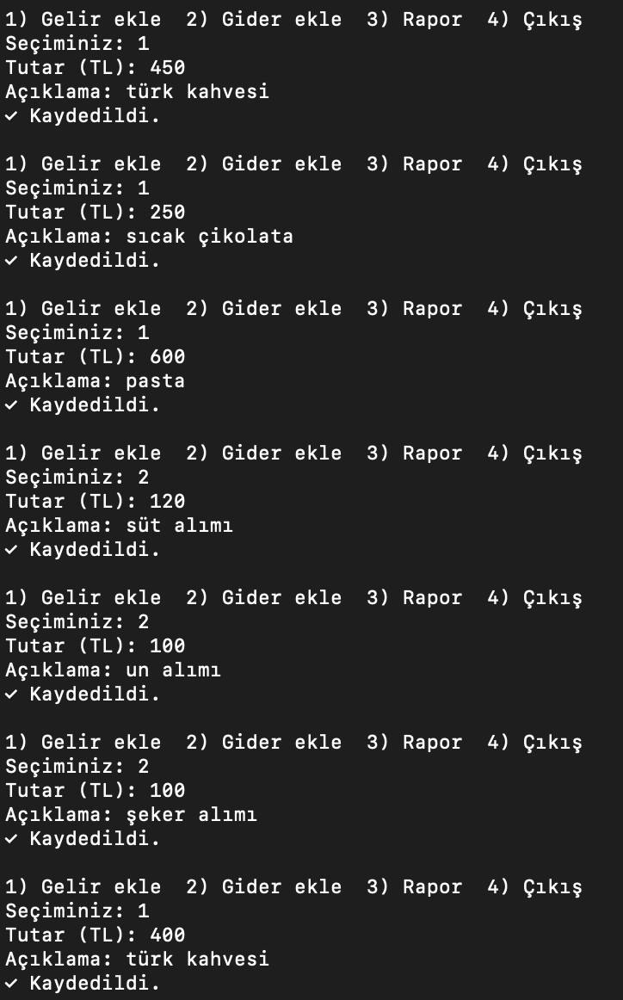
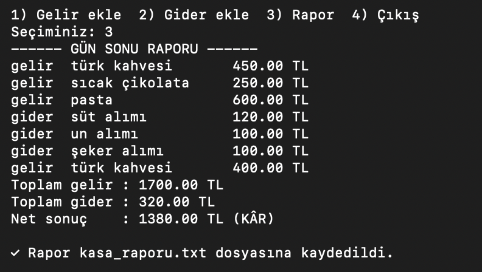
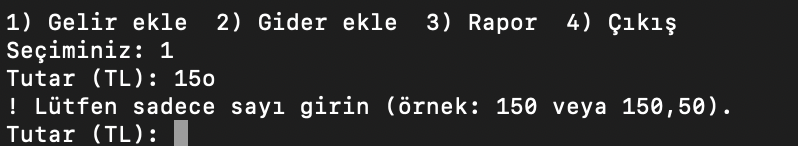
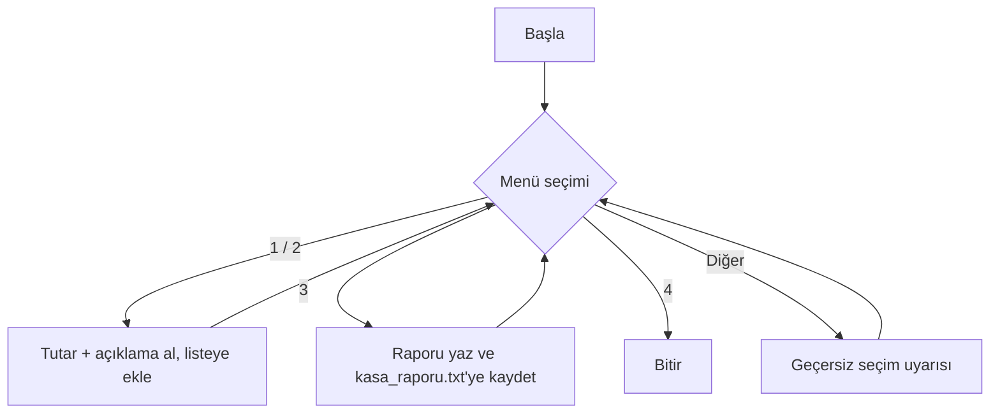

# Kasa Defteri

Küçük bir kafenin gün içindeki **gelir ve giderlerini** kaydeden, istendiğinde **gün sonu kâr/zarar raporu** hazırlayıp dosyaya kaydeden komut satırı uygulaması.

> GEP1316 Kodlama Okuryazarlığı – Ara Değerlendirme Ödevi 1 · Mevlüt Furkan Yılmaz · 2026-2027 Güz

## Ne yapar?

- Menüden **gelir** (örn. kahve satışı) veya **gider** (örn. süt, elektrik, kira) eklenir: tutar + açıklama.
- **Rapor** seçilince toplam gelir, toplam gider ve net sonuç (KÂR / ZARAR / BAŞABAŞ) ekrana yazılır ve `kasa_raporu.txt` dosyasına kaydedilir.
- Hatalı girdide çökmez, uyarı verip tekrar sorar: harf (`15o`, `150tl`), sıfır veya negatif tutar, noktalı tutar (`1.000`), geçersiz menü seçimi.
- Kuruş için virgül kullanılır: `150,50`.

## Nasıl çalıştırılır?

Python 3 yeterli, ek kütüphane gerekmez.

```bash
git clone https://github.com/mfurkanylmaz/kasa-defteri.git
cd kasa-defteri
python kasa_defteri.py
```

## Örnek çıktı

```
------ GÜN SONU RAPORU ------
gelir  Kahve satışı       450.00 TL
gider  Süt alışı          120.00 TL
Toplam gelir : 450.00 TL
Toplam gider : 120.00 TL
Net sonuç    : 330.00 TL (KÂR)
```

## Ekran görüntüleri

| Menü ve işlem ekleme | Gün sonu raporu | Hatalı girdi uyarısı |
|---|---|---|
|  |  |  |

## Akış şeması



## Kod yapısı

| Fonksiyon | Görevi |
|---|---|
| `sayi_al()` | Geçerli bir tutar girilene kadar sorar |
| `islem_ekle()` | Tutar ve açıklamayı alıp işlemi listeye ekler |
| `rapor_olustur()` | Toplamları ve kâr/zarar sonucunu hesaplar |
| `dosyaya_kaydet()` | Raporu `kasa_raporu.txt` dosyasına yazar |

Her işlem bir **sözlük**, tüm işlemler bir **liste**de tutulur:

```python
islemler = [
    {"tur": "gelir", "tutar": 450, "aciklama": "Kahve satışı"},
    {"tur": "gider", "tutar": 120, "aciklama": "Süt alışı"},
]
```

## Yapay zekâ kullanımı

Proje Claude (Anthropic) ile soru-cevap şeklinde geliştirildi; prompt'lar ve kararlar [PROMPTLAR.md](PROMPTLAR.md) dosyasında.

Anthropic. (2026). *Claude* (Opus 5.5) [Büyük dil modeli]. https://claude.ai
